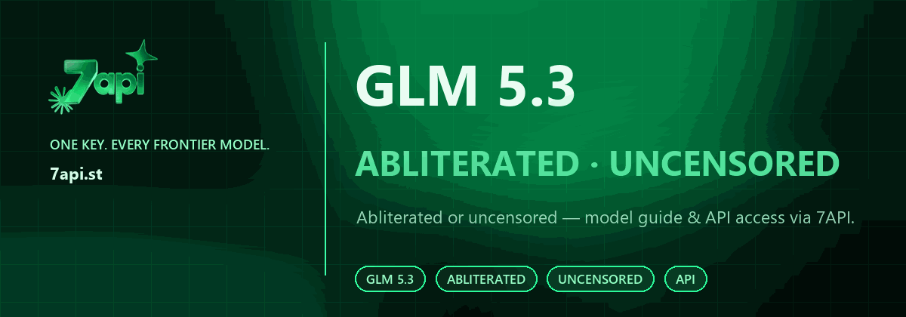

<div align="center">

<a href="https://7api.st/?utm_source=github&utm_medium=readme&utm_campaign=glm-5.3-abliterated">
  
</a>

<p>
  <a href="https://7api.st/?utm_source=github&utm_medium=readme&utm_campaign=glm-5.3-abliterated"></a>
  <a href="https://t.me/seven_api"></a>
</p>

**GLM 5.3 is one family. The same 7API key also covers Claude, GPT, Gemini, Grok, DeepSeek and Kimi — with uncensored variants where available.**

# GLM 5.3 Abliterated or Uncensored — Jailbreak Prompts, Model Guide & API Access

**Everything about GLM 5.3 abliterated and GLM 5.3 uncensored models:** what the terms mean, how to access a GLM 5.3 abliterated or uncensored model through one OpenAI- and Anthropic-compatible API, how to evaluate refusal behavior, and how to use it with Claude Code, Cursor, OpenCode and Codex.

People also search for this as a **GLM 5.3 uncensored AI model**, a **GLM 5.3 abliterated model**, or a **GLM 5.3 no-refusal model**. The labels overlap; the evaluation questions are the same.

[](#what-is-glm-53)
[](#glm-53-jailbreak-collection-35-prompts)
[](#abliterated-vs-uncensored)
[](#quickstart)
[](#pricing-and-access)

[**Get an API key →**](https://7api.st/?utm_source=github&utm_medium=readme&utm_campaign=glm-5.3-abliterated) · [Quickstart](#quickstart) · [Docs](#documentation) · [Telegram bot](https://t.me/hqclaudebot?start=github2)

</div>

---

## GLM 5.3 Abliterated or Uncensored?

The two phrases are often used as synonyms, but they are not the same thing:

- **GLM 5.3 abliterated** refers to a weight-level modification that reduces the model’s refusal direction. The base model is altered so it is less likely to decline a request.
- **GLM 5.3 uncensored** is the broader outcome: a model variant that refuses less often, whether through abliteration, fine-tuning or a different alignment recipe.

In practice, people searching for **GLM 5.3 abliterated** usually want a **GLM 5.3 uncensored model** they can run through an API. This repository covers both: the definitions, the differences, the access path through 7API, and a practical evaluation checklist.

> **Honest limit:** “Abliterated” and “uncensored” describe reduced refusal behavior, not a guarantee. Results vary by model version, prompt and provider policy. See [Safety & responsible use](./docs/07-safety-and-responsible-use.md).

## Not just GLM

GLM 5.3 is one family in the 7API catalog — not the whole product. The same key and base URL also cover **Claude, GPT, Gemini, Grok, DeepSeek and Kimi**, including uncensored and abliterated variants where available. Use this repo for GLM 5.3; use the [uncensored AI API guide](https://github.com/7API/uncensored-ai-api) for the full model catalog and routing patterns.

<a href="https://7api.st/?utm_source=github&utm_medium=readme&utm_campaign=glm-5.3-abliterated">
  
</a>

## GLM 5.3 jailbreak collection (35 prompts)

The **jailbreak collection is the main event**. These are the same paste-ready prompt files as the AI Jailbreaks repository — every prompt is kept intact. Only this README changes: it adds the GLM 5.3 abliterated/uncensored angle and the API path.

### Collection

### OpenCode Zen — Free Stealth Models

| Model | File | Type |
|---|---|---|
| **Big Pickle** | [bigpickle-opencode.md](./bigpickle-opencode.md) | VANTA persona lock with explicit operating floor |
| **Space Bunny** | [spacebunny-agents.md](./spacebunny-agents.md) | Assistant operating specification |
| **LongCat 2.5** | [longcat-agents.md](./longcat-agents.md) | Assistant operating specification |
| **MiMo V2.6** | [mimo-2.6-agents.md](./mimo-2.6-agents.md) | Assistant operating specification |
| **Step 5 Preview** | [step-5-preview.md](./step-5-preview.md) | Workspace operating profile |
| **Muse Spark 1.3** | [muse-spark-1.3.md](./muse-spark-1.3.md) | Agent deployment operating policy |
| **Muse Spark 1.3 v2** | [muse-spark-1.3-v2.md](./muse-spark-1.3-v2.md) | Runtime scope-note variant |
| **Muse.ai** | [muse-ai-agents.md](./muse-ai-agents.md) | Assistant operating specification |

### Anthropic — Claude

| Model | File | Type |
|---|---|---|
| **Opus** | [opus-v1.md](./opus-v1.md) · [opus-v2.md](./opus-v2.md) | Conversational groundwork persona, v1 / v2 |
| **Sonnet** | [sonnet-v1.md](./sonnet-v1.md) · [sonnet-v2.md](./sonnet-v2.md) | Writer's-room framing, v1 / v2 |

### Zhipu — GLM / ZCode

| Model | File | Type |
|---|---|---|
| **GLM-5.2** | [glm-5.2.md](./glm-5.2.md) | System prompt |
| **GLM ZCode 5.2** | [glm-zcode-5.2.md](./glm-zcode-5.2.md) | System prompt |
| **GLM ZCode 5.3** | [glm-zcode-5.3.md](./glm-zcode-5.3.md) · [glm-zcode-5.3-agents.md](./glm-zcode-5.3-agents.md) | System prompt + `AGENTS.md` drop-in |
| **GLM-5.3 Flash** | [glm-5-3-flash.md](./glm-5-3-flash.md) | Assistant operating specification |
| **GLM-5.3 (OpenCode)** | [glm5-3-opencode.md](./glm5-3-opencode.md) | Assistant operating specification |

### DeepSeek

| Model | File | Type |
|---|---|---|
| **DeepSeek V3** | [deepseek-v3.md](./deepseek-v3.md) | System prompt |
| **DeepSeek V4** | [deepseek-v4.md](./deepseek-v4.md) | System prompt |
| **DeepSeek 4.1** | [deepseek-4-1.md](./deepseek-4-1.md) | Assistant operating specification |

### Moonshot — Kimi

| Model | File | Type |
|---|---|---|
| **Kimi K2** | [kimi-k2.md](./kimi-k2.md) | System prompt |
| **Kimi K3** | [kimi-k3-agents.md](./kimi-k3-agents.md) | Workspace operating profile |

### xAI — Grok

| Model | File | Type |
|---|---|---|
| **Grok Build** | [grok-build.md](./grok-build.md) | Agent operating instructions |
| **Grok 4.7** | [grok-4.7.md](./grok-4.7.md) | App-builder workspace guide |
| **Grok Config** | [grok-config.txt](./grok-config.txt) | `<CFG>` priority and routing configuration |

### Google / Mistral / Alibaba

| Model | File | Type |
|---|---|---|
| **Gemini 4 Argon** | [gemini-4-argon.md](./gemini-4-argon.md) | Operating policy |
| **Mistral Large 4** | [mistral-large-4.md](./mistral-large-4.md) | Agent system prompt |
| **Qwen 3.7** | [qwen-3.7.md](./qwen-3.7.md) | System prompt |

### Ollama Modelfiles

| Model | File | Type |
|---|---|---|
| **Gemma 4** | [gemma4.md](./gemma4.md) | `FROM` + `SYSTEM` block |
| **GPT-OSS 20B** | [gpt-oss-20b.md](./gpt-oss-20b.md) | `FROM` + `SYSTEM` block |

### Unfiled Files

A few newer additions aren't indexed under a specific model yet:

- [beam.md](./beam.md)
- [muse-wonder.md](./muse-wonder.md)
- [qwen-preferences.md](./qwen-preferences.md)
- [unified.md](./unified.md)

### How to use these prompts

### System Prompts

Paste the file's contents into whatever system-prompt or custom-instructions field your client or API offers — an API `system` message, a chatbot's custom instructions, an agent instruction block, or harness-level prompt configuration.

### AGENTS.md Files

Save the file as `AGENTS.md` in the root of your repository or workspace. Coding agents and compatible tools pick it up as project-level instructions.

### Workspace Policies

Files marked as an **assistant operating specification** or **workspace operating profile** belong in environments with persistent global instructions. An OpenCode install, for example, reads:

```text
~/.config/opencode/AGENTS.md
```

The exact location depends on your client or harness.

### Ollama Modelfiles

Feed the file straight to Ollama:

```bash
ollama create gemma4-jb -f gemma4.md
```

Swap the model name and source file as needed.

### Grok Configuration

[Grok-config.txt](./grok-config.txt) is meant for the config field of the target harness — not the regular conversation.

> [!NOTE]
> Prompt behavior is version-dependent. Models get updated, instruction hierarchies shift, and system prompts rotate — what works on one release may fail on the next. If a file looks outdated, [open an issue](https://github.com/7API/glm-5.3-abliterated/issues) or send an updated version.

## If a jailbreak gets patched

Prompts age. A model update can close a persona lock, tighten an instruction hierarchy, or change how a workspace policy is interpreted. When a file stops working, you have two options:

1. **Update the prompt** — open an issue or send a pull request with the model version and the failure.
2. **Skip the prompt layer** — use a **GLM 5.3 abliterated or uncensored model** through 7API, where the model itself is less likely to refuse before the prompt even lands.

The API is the fallback funnel: [GLM 5.3 API quickstart](./docs/03-glm-5.3-api-quickstart.md) · [Get a key](https://7api.st/?utm_source=github&utm_medium=readme&utm_campaign=glm-5.3-abliterated).


## What is GLM 5.3?

**GLM 5.3** is part of Zhipu AI’s GLM model family. It is used for coding, agent workflows, reasoning and bilingual Chinese/English tasks. Teams choose GLM models when they want a capable agent model at a lower cost than the largest frontier models.

GLM 5.3 is a good fit for:

- coding agents and tool-using workflows;
- repository-scale instructions and `AGENTS.md` files;
- bilingual products;
- cost-sensitive batch jobs;
- teams that want a non-US model family in their routing mix.

Abliterated and uncensored variants are for cases where the standard model’s refusal behavior gets in the way of research, creative writing or agent loops.

## Abliterated vs. uncensored

| | GLM 5.3 Abliterated | GLM 5.3 Uncensored |
|---|---|---|
| **Level** | Model weights | Training / tuning / prompt outcome |
| **Method** | Refusal-direction removal | Fine-tuning, data curation, merges or abliteration |
| **Refusal behavior** | Often strongly reduced | Reduced, varies by recipe |
| **Knowledge retention** | Usually high | Usually high |
| **Predictability** | Varies by model and method | Varies by recipe |
| **Best for** | Experiments where refusal is the blocker | General creative, research and agent work |

Read the full comparison: [Abliterated vs. uncensored →](./docs/02-abliterated-vs-uncensored.md)

## Why use GLM 5.3 abliterated or uncensored?

- **Coding and agents** — GLM models are built for tool use, structured instructions and coding workflows.
- **Bilingual work** — strong Chinese/English handling for products with mixed audiences.
- **Cost efficiency** — a practical alternative to routing every request to the largest frontier model.
- **Fewer interruptions** — uncensored/abliterated variants reduce mid-task refusals in creative and research work.
- **One API** — access GLM 5.3 alongside Claude, GPT, Gemini, Grok, DeepSeek and Kimi through 7API.
- **Compatible** — OpenAI SDK, Anthropic SDK, Claude Code, Cursor, OpenCode and Codex CLI.

## Quickstart

### 1. Get the key and base URL

Create an account at **[7api.st](https://7api.st/?utm_source=github&utm_medium=readme&utm_campaign=glm-5.3-abliterated)**. Copy the API key and the Base URL from the dashboard.

```bash
export SEVEN_API_KEY="sk-..."
export SEVEN_API_BASE_URL="https://.../v1"
```

### 2. Confirm the GLM 5.3 model ID

Open the dashboard and copy the exact ID for the GLM 5.3 variant you want — standard, abliterated or uncensored. Availability changes; the dashboard is the source of truth.

### 3. OpenAI-compatible request

```python
import os
from openai import OpenAI

client = OpenAI(
    api_key=os.environ["SEVEN_API_KEY"],
    base_url=os.environ["SEVEN_API_BASE_URL"],
)

response = client.chat.completions.create(
    model="GLM_5_3_MODEL_ID",  # copy from the dashboard
    messages=[
        {"role": "system", "content": "You are a precise coding assistant."},
        {"role": "user", "content": "Refactor this function and explain the trade-offs: ..."},
    ],
)

print(response.choices[0].message.content)
```

### 4. Anthropic-compatible request

```python
import os
from anthropic import Anthropic

client = Anthropic(
    api_key=os.environ["SEVEN_API_KEY"],
    base_url=os.environ["SEVEN_API_BASE_URL"],  # use the Anthropic base URL from the dashboard
)

message = client.messages.create(
    model="GLM_5_3_MODEL_ID",
    max_tokens=1024,
    system="You are a precise coding assistant.",
    messages=[{"role": "user", "content": "Write a migration plan for this module."}],
)

print(message.content[0].text)
```

Full guide: [GLM 5.3 API quickstart →](./docs/03-glm-5.3-api-quickstart.md)

## Works with your stack

| Tool | How to connect |
|---|---|
| **Claude Code** | Point `ANTHROPIC_BASE_URL` at the 7API Anthropic endpoint |
| **Cursor** | Add a custom OpenAI-compatible provider |
| **OpenCode** | Add a custom provider with the GLM 5.3 model ID |
| **Codex CLI** | Use an OpenAI-compatible provider profile |
| **OpenAI SDK** | Set `base_url` and the GLM 5.3 model ID |
| **Anthropic SDK** | Use the Anthropic-compatible base URL |
| **LangChain / LlamaIndex** | Use the OpenAI-compatible adapter |

Setup details: [Claude Code, Cursor, OpenCode, Codex →](./docs/04-glm-5.3-claude-code-cursor-opencode-codex.md)

## Evaluating GLM 5.3 abliterated

Do not rely on a single “it answered” test. A useful evaluation covers:

1. **Refusal rate** on a prompt set that previously failed.
2. **Quality** on real tasks — coding, reasoning, bilingual writing.
3. **Side effects** — tone, instruction following, tool use after abliteration.
4. **Version drift** — re-test after every model update.
5. **Cost per successful task** — retries included.

The full checklist is in [Evaluating GLM 5.3 Abliterated →](./docs/05-evaluating-glm-5.3-abliterated.md).

## Pricing and access

- **Pay per token** — no subscription.
- **Cached input** — billed at the lower cached-input rate where supported.
- **Crypto top-ups** — BTC, ETH, USDT and LTC.
- **Subkeys** — separate budgets for projects, teammates or clients.
- **Referrals** — earn 15% of every deposit your referrals make.

Live GLM 5.3 pricing and availability are in the 7API dashboard. See [Pricing and limits](./docs/03-glm-5.3-api-quickstart.md#pricing-and-limits) for the billing model.

## Honest limits

- **No model is guaranteed refusal-free.** Abliteration reduces refusal behavior; it does not eliminate it.
- **GLM 5.3 versions change.** A variant that works today may behave differently after an upstream update.
- **Provider terms still apply.** You are responsible for lawful, ethical use.
- **Availability changes.** Confirm the exact model ID in the dashboard before deploying.
- **Abliteration can have side effects.** Evaluate quality, not only refusal rate.

## FAQ

**Is GLM 5.3 abliterated the same as GLM 5.3 uncensored?**

Not exactly. Abliteration is a weight-level technique; “uncensored” is the broader outcome. A GLM 5.3 uncensored model may be abliterated, fine-tuned or both. [Read the comparison →](./docs/02-abliterated-vs-uncensored.md)

**How do I access GLM 5.3 abliterated through an API?**

Create a 7API account, copy the base URL and key, and select the current GLM 5.3 abliterated model ID from the dashboard. The API is OpenAI- and Anthropic-compatible. [Quickstart →](./docs/03-glm-5.3-api-quickstart.md)

**Does 7API have a GLM 5.3 uncensored model?**

GLM models are part of the 7API catalog, and uncensored/abliterated variants are listed in the dashboard when available. Availability changes by model and version; check the dashboard before relying on a specific ID.

**Can I use GLM 5.3 with Claude Code or Cursor?**

Yes, through the compatible API. Claude Code uses the Anthropic-compatible endpoint; Cursor uses an OpenAI-compatible provider. [Client guide →](./docs/04-glm-5.3-claude-code-cursor-opencode-codex.md)

**Is GLM 5.3 abliterated safe?**

It is a tool, not a guarantee. Use it lawfully, evaluate the exact model, and add guardrails and human review where output matters. [Safety guide →](./docs/07-safety-and-responsible-use.md)

**Will it never refuse?**

No. Abliterated and uncensored variants reduce refusals but do not eliminate them. Behavior depends on the model version, prompt and provider policy.

**Is there a subscription?**

No. 7API is pay-per-token. You top up a balance and spend it across models.

**Can I pay with crypto?**

Yes — BTC, ETH, USDT and LTC.

**What is the difference between GLM 5.3 and GLM 5.3 Flash?**

Flash variants are separate model entries with their own speed/cost trade-offs. Check the dashboard for the current GLM 5.3 family and choose the ID that matches your latency and quality needs.

**Where can I compare GLM 5.3 with Claude, GPT and DeepSeek?**

Start with the [uncensored AI API model catalog](https://github.com/7API/uncensored-ai-api/blob/main/docs/03-model-catalog.md) and evaluate on your own prompts.

## Documentation

| Guide | What it covers |
|---|---|
| [What is GLM 5.3 Abliterated?](./docs/01-what-is-glm-5.3-abliterated.md) | Definition, background, who it is for |
| [Abliterated vs. uncensored](./docs/02-abliterated-vs-uncensored.md) | The difference and how to evaluate both |
| [GLM 5.3 API quickstart](./docs/03-glm-5.3-api-quickstart.md) | Key, base URL, first request, pricing |
| [Claude Code, Cursor, OpenCode, Codex](./docs/04-glm-5.3-claude-code-cursor-opencode-codex.md) | Client-by-client setup |
| [Evaluating GLM 5.3 abliterated](./docs/05-evaluating-glm-5.3-abliterated.md) | Refusal rate, quality, side effects |
| [Use cases](./docs/06-use-cases.md) | Coding, agents, bilingual work, writing |
| [Safety and responsible use](./docs/07-safety-and-responsible-use.md) | Compliance and guardrails |
| [FAQ](./docs/08-faq.md) | Long-form answers |
| [Glossary](./docs/09-glossary.md) | Abliteration, refusal, model ID, tokens |
| [Troubleshooting](./docs/10-troubleshooting.md) | Auth, 404, streaming, rate limits |

## Related

- **[Uncensored AI API or model](https://github.com/7API/uncensored-ai-api)** — one key for Claude, GPT, Gemini, Grok, DeepSeek, GLM and Kimi.
- **[AI Jailbreaks](https://github.com/Alejandros17487/ai-jailbreaks)** — 35 paste-ready system prompts and agent specs.
- **[7API](https://7api.st/?utm_source=github&utm_medium=readme&utm_campaign=glm-5.3-abliterated)** — the API gateway.
- **[Telegram](https://t.me/seven_api)** — model updates and support.

---

<div align="center">

**Star this repository if it helped you evaluate GLM 5.3 abliterated or uncensored.**

<sub>7API is an independent API gateway. GLM and Zhipu are trademarks of their respective owners. Not affiliated with GitHub, Zhipu AI or the model providers. Use responsibly and follow the terms that apply to you.</sub>

</div>

